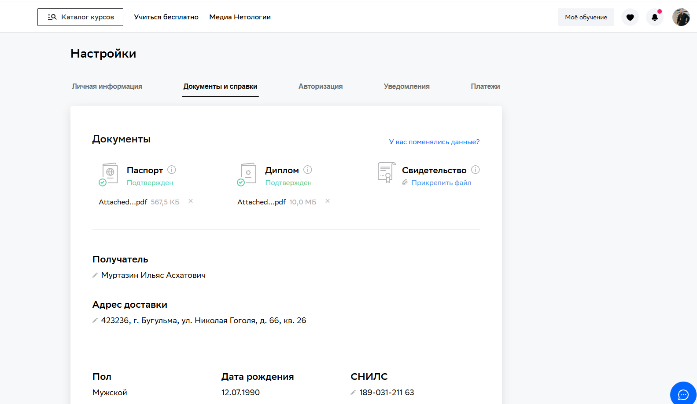
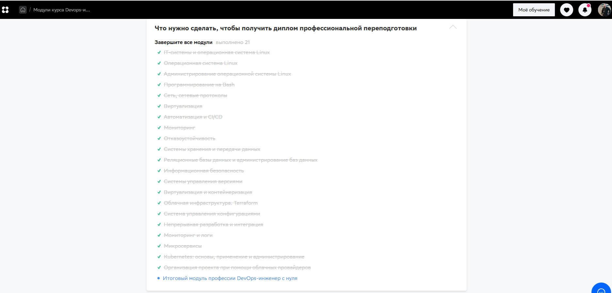

# Задание

## Вопросы по заданию

Для получения доступа к дипломной работе ответьте, пожалуйста, на несколько вопросов.

## 1. Получилось ли у вас загрузить в личный кабинет документы, подтверждающие личность, и диплом о высшем или среднем специальном образовании?

### а) Да
Пришлите ссылку на скриншот личного кабинета.

[Ссылка на скриншот](https://github.com/murtazinilyas/mia_pre_diplom/blob/main/ЛК_МИА.png)

б) Нет, но сделаю это в ближайшее время. Инструкция по загрузке документов в личный кабинет.
в) Не загрузил диплом, у меня его нет

---

## 2. Нужна ли вам справка об обучении после сдачи дипломной работы? Справка выдаётся всем студентам, в том числе тем, у кого нет диплома о высшем или среднем специальном образовании.

а) Да
После получения зачёта по дипломной работе напишите в чат поддержки.

### б) Нет

---

## 3. Выполнен ли вами необходимый минимум заданий на каждом модуле профессии для допуска к дипломной работе?

### а) Да

Поздравляем! Сообщим вам позже, кто будет вашим дипломным руководителем.

б) Нет
В этом случае у вас нет допуска к дипломной работе. Если вы хотите сдать домашние работы на закрытых модулях, свяжитесь с координатором вашей профессии.
